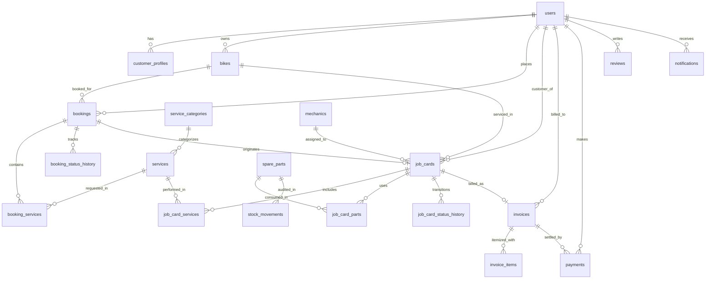

# BikeFix Club — Database Design & Schema Specification

**Application:** BikeFix Club  
**Engine:** MySQL 8+ / 9.5 (InnoDB)  
**Encoding:** `utf8mb4_unicode_ci`  
**Total Tables:** 24 relational tables  
**Integrity:** Foreign Key Constraints with Referential Actions

---

## 1. Entity-Relationship Overview

The database is structured into 7 core domains:
1. **Identity & Access:** `users`, `customer_profiles`, `password_resets`, `audit_logs`
2. **Vehicles & Catalogue:** `bikes`, `service_categories`, `services`
3. **Bookings & Tracking:** `bookings`, `booking_services`, `booking_status_history`
4. **Workshop Operations:** `mechanics`, `job_cards`, `job_card_services`, `job_card_parts`, `job_card_status_history`
5. **Inventory Ledger:** `spare_parts`, `stock_movements`
6. **Billing & Finances:** `invoices`, `invoice_items`, `payments`, `expenses`
7. **Engagement & Operations:** `reviews`, `notifications`, `workshop_settings`, `contact_inquiries`

---

## 2. Table Specifications

### 2.1 Identity & Access

#### `users`
Primary authentication and account identity table.
| Column | Type | Constraints | Description |
|---|---|---|---|
| `id` | BIGINT UNSIGNED | PK, AUTO_INCREMENT | Unique user identifier |
| `name` | VARCHAR(120) | NOT NULL | Full name of user |
| `email` | VARCHAR(191) | NOT NULL, UNIQUE | Primary email address |
| `phone` | VARCHAR(30) | NOT NULL, UNIQUE | Mobile contact number |
| `password_hash` | VARCHAR(255) | NOT NULL | BCRYPT password hash |
| `role` | ENUM | NOT NULL, DEFAULT 'customer' | `'admin'`, `'customer'`, `'mechanic'`, `'staff'` |
| `account_status` | ENUM | NOT NULL, DEFAULT 'active' | `'active'`, `'inactive'`, `'suspended'` |
| `last_login` | DATETIME | NULL | Timestamp of last session |
| `created_at` | DATETIME | NOT NULL, DEFAULT CURRENT_TIMESTAMP | Record creation timestamp |
| `updated_at` | DATETIME | NOT NULL, DEFAULT CURRENT_TIMESTAMP ON UPDATE | Last update timestamp |

#### `customer_profiles`
Detailed contact and address information for customers.
| Column | Type | Constraints | Description |
|---|---|---|---|
| `id` | BIGINT UNSIGNED | PK, AUTO_INCREMENT | Profile identifier |
| `user_id` | BIGINT UNSIGNED | NOT NULL, UNIQUE, FK -> `users.id` ON DELETE CASCADE | Associated user |
| `address` | VARCHAR(255) | NULL | Street address |
| `city` | VARCHAR(100) | NOT NULL, DEFAULT 'Aruppukkottai' | City name |
| `state` | VARCHAR(100) | NOT NULL, DEFAULT 'Tamil Nadu' | State name |
| `postal_code` | VARCHAR(20) | NOT NULL, DEFAULT '626101' | Postal / PIN code |

---

### 2.2 Vehicles & Catalogue

#### `bikes`
Customer registered motorcycles.
| Column | Type | Constraints | Description |
|---|---|---|---|
| `id` | BIGINT UNSIGNED | PK, AUTO_INCREMENT | Bike identifier |
| `customer_user_id` | BIGINT UNSIGNED | NOT NULL, FK -> `users.id` ON DELETE RESTRICT | Owner user ID |
| `registration_number` | VARCHAR(40) | NOT NULL, INDEX | License plate number (e.g. TN-67-AB-1234) |
| `brand` | VARCHAR(80) | NOT NULL | Manufacturer (e.g. Yamaha, Royal Enfield) |
| `model` | VARCHAR(100) | NOT NULL | Model designation (e.g. Classic 350, MT-15) |
| `variant` | VARCHAR(80) | NULL | Sub-variant or edition |
| `manufacturing_year` | SMALLINT UNSIGNED | NULL | Year of manufacture |
| `fuel_type` | VARCHAR(30) | NOT NULL, DEFAULT 'Petrol' | Fuel type |
| `current_odometer` | INT UNSIGNED | NOT NULL, DEFAULT 0 | Latest recorded odometer (km) |
| `is_active` | TINYINT(1) | NOT NULL, DEFAULT 1 | Active or archived flag |

#### `services`
Catalogue of standardized workshop service offerings.
| Column | Type | Constraints | Description |
|---|---|---|---|
| `id` | BIGINT UNSIGNED | PK, AUTO_INCREMENT | Service identifier |
| `category_id` | BIGINT UNSIGNED | NOT NULL, FK -> `service_categories.id` | Category classification |
| `name` | VARCHAR(150) | NOT NULL | Service title |
| `slug` | VARCHAR(160) | NOT NULL, UNIQUE | URL-friendly slug |
| `description` | TEXT | NULL | Detailed service description |
| `estimated_duration_minutes` | INT UNSIGNED | NOT NULL, DEFAULT 60 | Typical labor time in minutes |
| `base_price` | DECIMAL(10,2) | NOT NULL | Standard labor charge |
| `is_active` | TINYINT(1) | NOT NULL, DEFAULT 1 | Publicly visible flag |

---

### 2.3 Workshop Operations & Job Cards

#### `job_cards`
Authoritative digital work order for all workshop servicing.
| Column | Type | Constraints | Description |
|---|---|---|---|
| `id` | BIGINT UNSIGNED | PK, AUTO_INCREMENT | Job card identifier |
| `job_card_reference` | VARCHAR(40) | NOT NULL, UNIQUE | Formatted ref (e.g. JC-2026-0001) |
| `booking_id` | BIGINT UNSIGNED | NULL, FK -> `bookings.id` | Optional booking reference |
| `customer_user_id` | BIGINT UNSIGNED | NOT NULL, FK -> `users.id` | Customer owner |
| `bike_id` | BIGINT UNSIGNED | NOT NULL, FK -> `bikes.id` | Motorcycle serviced |
| `assigned_mechanic_id`| BIGINT UNSIGNED | NULL, FK -> `mechanics.id` | Assigned lead technician |
| `status` | ENUM | NOT NULL, DEFAULT 'created' | `'created'`, `'checked_in'`, `'diagnosis'`, `'repair_in_progress'`, `'quality_check'`, `'ready_for_delivery'`, `'delivered'`, `'cancelled'` |
| `reported_problem` | TEXT | NOT NULL | Customer complaint / requested work |
| `inspection_findings`| TEXT | NULL | Mechanic inspection diagnosis |
| `recommended_work` | TEXT | NULL | Technician repair suggestions |
| `approved_work` | TEXT | NULL | Customer authorized repairs |
| `initial_odometer` | INT UNSIGNED | NOT NULL, DEFAULT 0 | Inward odometer reading |
| `final_odometer` | INT UNSIGNED | NULL | Outward odometer reading after test |
| `check_in_at` | DATETIME | NULL | Timestamp vehicle was checked into shop |
| `delivered_at` | DATETIME | NULL | Timestamp vehicle was handed back to customer |

---

### 2.4 Inventory & Concurrency Ledger

#### `spare_parts`
Spare parts master inventory table.
| Column | Type | Constraints | Description |
|---|---|---|---|
| `id` | BIGINT UNSIGNED | PK, AUTO_INCREMENT | Part identifier |
| `sku` | VARCHAR(60) | NOT NULL, UNIQUE | Stock keeping unit |
| `name` | VARCHAR(180) | NOT NULL | Part description / name |
| `category` | VARCHAR(80) | NOT NULL | Category (e.g. Engine Oil, Brake Pads) |
| `brand` | VARCHAR(80) | NOT NULL | Manufacturer (e.g. Motul, Brembo) |
| `purchase_price` | DECIMAL(10,2) | NOT NULL | Cost price per unit |
| `selling_price` | DECIMAL(10,2) | NOT NULL | Counter billing price per unit |
| `stock_quantity` | INT NOT NULL | DEFAULT 0 | Available balance (locked FOR UPDATE) |
| `minimum_stock` | INT NOT NULL | DEFAULT 5 | Low-stock threshold |

#### `stock_movements`
Immutable audit ledger recording all physical stock mutations.
| Column | Type | Constraints | Description |
|---|---|---|---|
| `id` | BIGINT UNSIGNED | PK, AUTO_INCREMENT | Movement log ID |
| `part_id` | BIGINT UNSIGNED | NOT NULL, FK -> `spare_parts.id` | Part altered |
| `movement_type` | ENUM | NOT NULL | `'inward'`, `'usage'`, `'adjustment'`, `'return'` |
| `quantity_change` | INT NOT NULL | Positive for inward, negative for usage |
| `unit_cost` | DECIMAL(10,2) | NOT NULL | Cost price at moment of movement |
| `reference_type` | VARCHAR(60) | NOT NULL | `'job_card'`, `'purchase_order'`, `'manual_audit'` |
| `reference_id` | VARCHAR(60) | NOT NULL | Reference document identifier |
| `reason` | VARCHAR(255) | NULL | Justification for stock mutation |
| `user_id` | BIGINT UNSIGNED | NOT NULL, FK -> `users.id` | Staff member who initiated change |
| `created_at` | DATETIME | NOT NULL, DEFAULT CURRENT_TIMESTAMP | Audit timestamp |

---

### 2.5 Invoicing & Billing

#### `invoices`
Formal financial document for workshop services and components.
| Column | Type | Constraints | Description |
|---|---|---|---|
| `id` | BIGINT UNSIGNED | PK, AUTO_INCREMENT | Invoice identifier |
| `invoice_number` | VARCHAR(40) | NOT NULL, UNIQUE | Sequential invoice number (INV-YYYY-XXXX) |
| `job_card_id` | BIGINT UNSIGNED | NOT NULL, UNIQUE, FK -> `job_cards.id` | Source job card |
| `customer_user_id` | BIGINT UNSIGNED | NOT NULL, FK -> `users.id` | Customer billed |
| `subtotal` | DECIMAL(10,2) | NOT NULL, DEFAULT 0.00 | Total parts and labour before tax |
| `discount` | DECIMAL(10,2) | NOT NULL, DEFAULT 0.00 | Promotional or loyalty discount |
| `tax_rate` | DECIMAL(5,2) | NOT NULL, DEFAULT 18.00 | Applicable GST percentage |
| `tax_amount` | DECIMAL(10,2) | NOT NULL, DEFAULT 0.00 | Calculated GST total |
| `total_amount` | DECIMAL(10,2) | NOT NULL, DEFAULT 0.00 | Subtotal - Discount + Tax |
| `amount_paid` | DECIMAL(10,2) | NOT NULL, DEFAULT 0.00 | Cumulative payments received |
| `outstanding_balance`| DECIMAL(10,2) | NOT NULL, DEFAULT 0.00 | Remaining unpaid balance |
| `status` | ENUM | NOT NULL, DEFAULT 'issued' | `'issued'`, `'partially_paid'`, `'paid'`, `'cancelled'` |
| `issue_date` | DATE NOT NULL | Date issued |
| `due_date` | DATE NOT NULL | Due date for payment |

#### `payments`
Recorded settlement transactions.
| Column | Type | Constraints | Description |
|---|---|---|---|
| `id` | BIGINT UNSIGNED | PK, AUTO_INCREMENT | Payment transaction ID |
| `invoice_id` | BIGINT UNSIGNED | NOT NULL, FK -> `invoices.id` | Settled invoice |
| `payment_reference` | VARCHAR(60) | NOT NULL, UNIQUE | Internal ref (e.g. PAY-2026-XXXX) |
| `payment_method` | ENUM | NOT NULL | `'cash'`, `'upi_workshop'`, `'card_workshop'`, `'razorpay_online'`, `'bank_transfer'` |
| `provider` | VARCHAR(60) | NOT NULL, DEFAULT 'counter' | Payment provider (Razorpay, Counter) |
| `provider_transaction_id` | VARCHAR(120) | NULL | External gateway transaction reference |
| `amount` | DECIMAL(10,2) | NOT NULL | Transaction amount |
| `currency` | VARCHAR(10) | NOT NULL, DEFAULT 'INR' | Currency code |
| `status` | ENUM | NOT NULL, DEFAULT 'successful' | `'initiated'`, `'successful'`, `'failed'`, `'refunded'` |
| `paid_at` | DATETIME | NOT NULL, DEFAULT CURRENT_TIMESTAMP | Moment of transaction verification |

---

### 2.6 Reviews & Moderation

#### `reviews`
Verified customer feedback table.
| Column | Type | Constraints | Description |
|---|---|---|---|
| `id` | BIGINT UNSIGNED | PK, AUTO_INCREMENT | Review ID |
| `booking_id` | BIGINT UNSIGNED | NOT NULL, UNIQUE, FK -> `bookings.id` | Single review per completed booking |
| `customer_user_id` | BIGINT UNSIGNED | NOT NULL, FK -> `users.id` | Author |
| `rating` | TINYINT UNSIGNED | NOT NULL | Star rating (1 to 5) |
| `comment` | TEXT NOT NULL | Detailed written feedback |
| `moderation_status` | ENUM | NOT NULL, DEFAULT 'pending' | `'pending'`, `'approved'`, `'rejected'` |
| `admin_response` | TEXT | NULL | Public workshop manager response |
| `responded_at` | DATETIME | NULL | Timestamp of response |

---

## 3. Indexing & Optimization Strategy

1. **Foreign Key Indexing:** Every foreign key column has an explicit B-tree index to guarantee sub-millisecond table joins.
2. **Search Indexing:** High-frequency search fields (`bikes.registration_number`, `spare_parts.sku`, `invoices.invoice_number`, `bookings.booking_reference`) feature unique or indexed b-trees.
3. **Date Filters:** Analytical tables (`payments.paid_at`, `bookings.preferred_date`, `stock_movements.created_at`) have compound date indexes for fast reporting queries.
